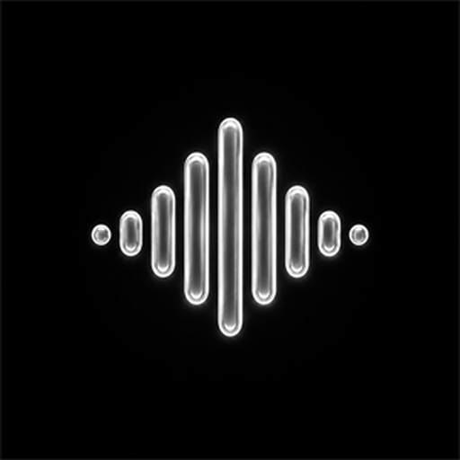

<div align="center">



# BeatWave PC

**The Ultimate Ad-Free, Hi-Res Desktop Music Player**

Crafted with passion by **[Vortex Apps](https://github.com/vortexapps)** · Powered by Kotlin & Compose Multiplatform

[](https://github.com/vortexapps67/beatwavepc/releases)
[](https://github.com/vortexapps67/beatwavepc/releases)
[](LICENSE)
[](https://beatwave.de5.net)

[**Downloads**](#-downloads) · [**Features**](#-features) · [**Android Companion**](#-android-app) · [**Support**](#-support--donations) · [**Building**](#-building-from-source)

</div>

---

## 🌊 Overview

**BeatWave PC** is a modern, high-fidelity native desktop music player that brings the beloved ad-free streaming experience of BeatWave to Windows and Linux. Enjoy unlimited music streaming from YouTube Music with studio-grade audio processing, seamless crossfading, synchronized lyrics, and a fluid, hardware-accelerated interface.

---

## ✨ Features

- **⚡ Dual-Deck Audio Engine**: True dual-deck crossfade engine powered by native audio gain nodes. Seamlessly blend between tracks on manual skips or track endings with an equal-power trigonometric curve.
- **🎨 Fluid Album Art Morph**: Liquid glass transitions and organic cubic-bezier scaling between track covers, paired with dynamic ambient mesh glows that breathe with your music.
- **🎚️ 10-Band Equalizer**: Comprehensive audio shaping with custom presets (Bass Boost, Vocal, Rock, Pop, Electronic) and tone balance sliders directly accessible from the player.
- **📜 Synced Word & Line Lyrics**: Syllable-timed lyrics with multiple fallback providers (Genius, LrcLib, YouTube, and embedded tags), word-by-word highlighting, and translation support.
- **🎧 High-Resolution Playback**: Lossless FLAC, Hi-Res audio decoding, Opus stream optimization, and local offline caching for instantaneous playback.
- **🪟 Native Windows Feel**: Standard Windows caption controls, Windows Media Overlay (SMTC) integration, taskbar audio controls, and Lenis-inspired smooth inertia scrolling.
- **🚫 Zero Telemetry & 100% Ad-Free**: No trackers, no ad breaks, no forced accounts, and completely free and open-source.

---

## 📦 Downloads

Grab the latest **v3.0.0** packages for Windows:

| Package | Format | Description |
| :--- | :--- | :--- |
| **BeatWave PC Setup** | `.exe` | Recommended installer with automatic shortcuts and desktop integration |
| **BeatWave PC Portable** | `.zip` | Zero-install standalone archive. Extract and run `BeatWave PC.exe` |
| **BeatWave PC Slim Portable** | `.zip` | Lightweight standalone distribution with streamlined dependencies |
| **BeatWave PC Installer** | `.msi` | Enterprise/standard Windows Installer package |

👉 **[Download All Releases on GitHub](https://github.com/vortexapps67/beatwavepc/releases/latest)**

---

## 📱 Android App

Looking for BeatWave on mobile? Get the Android companion app featuring an iOS-inspired Liquid Glass interface, real-time background blur, and offline download support.

🌐 **Website:** [beatwave.de5.net](https://beatwave.de5.net)  
📲 **Download APK:** [beatwave.de5.net](https://beatwave.de5.net)

---

## 💖 Support & Donations

BeatWave is developed independently by **Vortex Apps**. If you love the app and want to support ongoing development, server costs, and new features:

- **UPI ID:** `akshanshsinha67@axl`
- **UPI QR Code:** Scan `Upi_support.png` via Google Pay, PhonePe, or Paytm.
- **Instagram:** [@vortex.apps](https://instagram.com/vortex.apps)
- **GitHub:** [@vortexapps](https://github.com/vortexapps)

---

## 🛠️ Building from Source

### Prerequisites
- **JDK 21** or later
- **Gradle 8.11+** (or use bundled `gradlew`)
- **Windows 10/11** (x64) or **Linux** (x86_64)

### Run Locally
```powershell
# Run the Desktop app in development mode
.\gradlew.bat :desktopApp:run
```

### Build Installers & Packages
```powershell
# Build Windows EXE, MSI and Portable distributions
.\gradlew.bat :desktopApp:packageExe :desktopApp:packageMsi :desktopApp:packageZip
```

---

## 📄 License & Attribution

BeatWave PC is released under the **GNU General Public License v3.0** (GPL-3.0).  
Originally built upon the foundational work of the open-source community and continued by [Vortex Apps](https://github.com/vortexapps).
